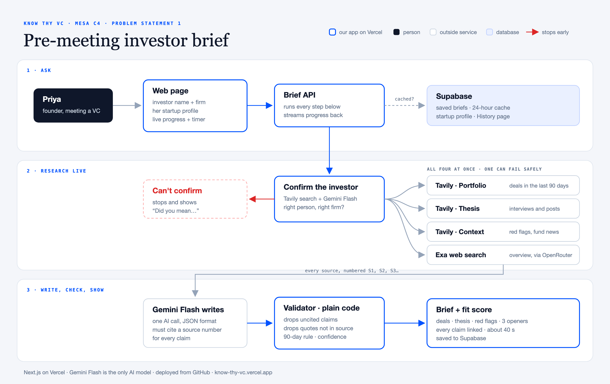

# Components Map

## 1 · Ask
- **Priya** types an investor's name and firm. Her startup profile is saved once and used for every brief.
- **Web page** (Next.js on Vercel) sends the request and shows live progress with a timer.
- **Brief API** runs every step below and streams progress back.
- **Supabase** stores saved briefs, the startup profile and a 24-hour cache. If the same investor was briefed in the last 24 hours for the same profile, the saved brief comes back in about a second.

## 2 · Research live
- **Confirm the investor:** a Tavily search, judged by Gemini Flash, checks it's the right person at that firm. If not, the app stops and shows "Did you mean…" suggestions, so no money is spent on the wrong person.
- **Four searches run at once**, each with a time limit. If one fails, the brief still renders and that section is marked low confidence.
  - Tavily · Portfolio: deals in the last 90 days
  - Tavily · Thesis: interviews and posts
  - Tavily · Context: red flags and fund news
  - Exa web search through OpenRouter: a live overview

## 3 · Write, check, show
- **Gemini Flash writes** the brief in one call, in a fixed JSON format, and must cite a numbered source (S1, S2…) for every claim. It never writes links itself.
- **Validator** (plain code, no AI) drops claims citing a source we didn't fetch, drops quotes that aren't word for word in their source, moves deals older than 90 days to "older activity" and sets a confidence level per section.
- **Brief + fit score:** recent deals, thesis, red flags and three talking points, every claim linked. The fit score is calculated in code from the checked brief. A brief takes about 40 seconds and is saved to Supabase.

Gemini Flash is the only AI model used. To redraw the map: `python3 scripts/components-map.py`, then export `docs/components-map.svg` to PNG.
